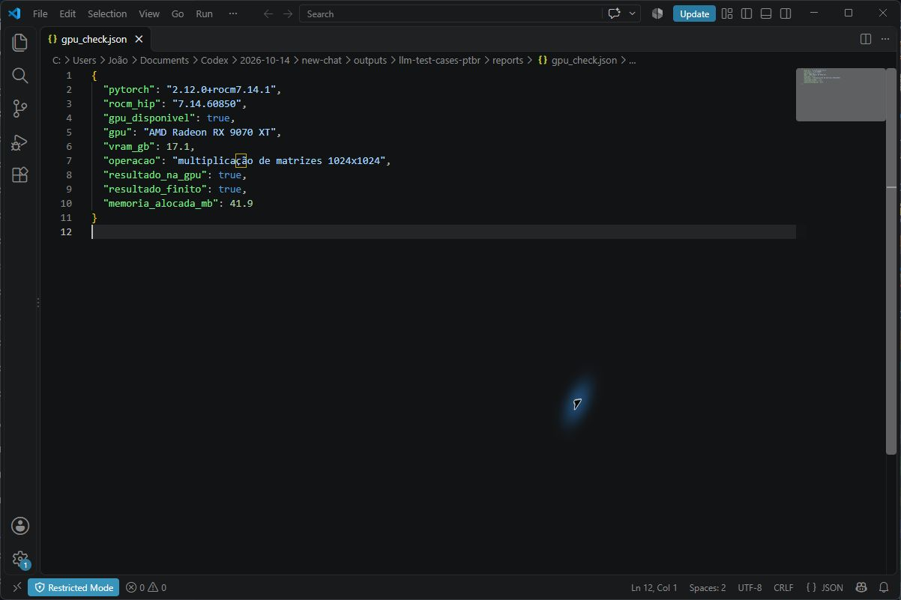

# POC - gerar testes de software em linguagem natural

Projeto da disciplina **Generative AI for Engineering**. Um modelo de linguagem local recebe um requisito curto de validação de formulário e gera três casos de teste em JSON. O projeto compara o modelo original com três ajustes finos LoRA, mede as respostas em prompts não vistos e oferece uma interface web local.

## Problema e modelo escolhido

- **Problema:** transformar requisitos de validação em casos de teste executáveis, com entrada e resultado esperado.
- **Modelo base:** [`Qwen/Qwen2.5-1.5B-Instruct`](https://huggingface.co/Qwen/Qwen2.5-1.5B-Instruct), licença Apache 2.0.
- **Método:** ajuste fino supervisionado com LoRA, treinando projeções `q_proj` e `v_proj`; os demais pesos ficam congelados.
- **Idioma:** português do Brasil.
- **Formato de saída:** `{"casos":[{"titulo":"...","entrada":"...","resultado_esperado":"..."}]}`.

### Alternativas consideradas

| Modelo | Parâmetros | Licença indicada pelo autor | Decisão |
|---|---:|---|---|
| [Qwen2.5-0.5B-Instruct](https://huggingface.co/Qwen/Qwen2.5-0.5B-Instruct) | 0,49 bi | Apache 2.0 | Menor custo, mas menos capacidade por tamanho; alternativa para PCs mais modestos. |
| [Qwen2.5-1.5B-Instruct](https://huggingface.co/Qwen/Qwen2.5-1.5B-Instruct) | 1,54 bi | Apache 2.0 | **Escolhido:** português, saída estruturada, licença simples e treino confirmado nesta GPU. |
| [Qwen2.5-3B-Instruct](https://huggingface.co/Qwen/Qwen2.5-3B-Instruct) | 3,09 bi | Qwen Research | Maior e com outras condições de licença; dispensável para o escopo. |
| [Llama 3.2 3B Instruct](https://huggingface.co/meta-llama/Llama-3.2-3B-Instruct) | ~3 bi | Llama 3.2 Community | Requer aceitar as condições da Meta; não oferece vantagem comprovada neste experimento. |

As observações de capacidade por tamanho são hipóteses de seleção, não resultados de um benchmark entre esses quatro modelos. A comparação experimental abaixo varia os parâmetros do ajuste fino do modelo escolhido.

## Hardware utilizado

| Componente | Configuração |
|---|---|
| GPU | AMD Radeon RX 9070 XT, 16 GB de VRAM dedicada |
| CPU | AMD Ryzen 7 7800X3D |
| RAM | 32 GB |
| Sistema | Windows 11 Pro |
| Driver | AMD Adrenalin 26.8.1 |
| Python | 3.13 |
| PyTorch | 2.12.0+rocm7.14.1 |

[`reports/gpu_check.json`](reports/gpu_check.json) registra uma multiplicação de matrizes executada na GPU. Em PyTorch com ROCm, a GPU AMD é acessada pela API chamada `torch.cuda`; `torch.version.hip` confirma o runtime ROCm.
O relatório mostra cerca de 17,1 GB em unidade decimal, equivalentes a aproximadamente 15,9 GiB; é a mesma VRAM anunciada como 16 GB.

**Espaço em disco medido neste PC:** ambiente Python 4,50 GB, cache do modelo 2,89 GB e adaptadores/execuções menos de 0,1 GB. Havia entre 74 e 80 GB livres no C: durante as medições após a configuração. Reserve **pelo menos 20 GB livres** para instalar, baixar e reproduzir este projeto; **30 GB** dão folga para arquivos temporários e novas execuções. Os pesos do modelo base ficam no cache e não entram no GitHub.

## Dados

`src/make_dataset.py` gera **240 requisitos sintéticos** com respostas de referência. Há 192 exemplos em `train`, 24 em `validation` e 24 em `test`. Os requisitos são únicos e cada um aparece em apenas uma partição. `data/challenge.jsonl` contém mais 12 requisitos escritos separadamente, com frases diferentes das usadas nos moldes de treino.

Os exemplos cobrem seis tipos de regra: campo obrigatório, comprimento de texto, faixa de inteiros, sintaxe de email, opções permitidas e ordem de datas. O conjunto sintético é adequado para demonstrar adaptação de formato e regras simples. **A avaliação não prova desempenho em requisitos complexos ou em categorias fora dessas seis regras.** Antes de ampliar o uso, o grupo deve acrescentar exemplos reais revisados por pessoas.

## Preparar o ambiente no Windows

Execute os comandos em PowerShell, **na raiz deste repositório** (a pasta que contém `requirements.txt` e `src`). Se o terminal mostrar `...\new-chat>`, entre primeiro com `Set-Location .\outputs\llm-test-cases-ptbr`. A [documentação da AMD](https://rocm.docs.amd.com/projects/ai-ecosystem/en/latest/frameworks/pytorch/install.html?fam=radeon&gfx=gfx1201&gpu=rx-9070-xt&i=pip&os=windows&pytorch-ver=2.12.0&w=compute) descreve a instalação para `gfx1201` e a [matriz de compatibilidade](https://rocm.docs.amd.com/en/docs-7.14.1/compatibility/compatibility-matrix.html) deve ser consultada se o driver mudar.


## Reproduzir treino e avaliação

```powershell
& $python src\make_dataset.py
& $python src\evaluate.py --name baseline --output reports\baseline.json
& $python src\train.py --name lora-r16-lr2e4 --rank 16 --lr 0.0002 --epochs 2 --run-dir runs\lora-r16-lr2e4
& $python src\evaluate.py --name lora-r16-lr2e4 --adapter runs\lora-r16-lr2e4\adapter --output reports\lora-r16-lr2e4.json
& $python src\evaluate.py --name desafio-r16 --split challenge --adapter runs\lora-r16-lr2e4\adapter --output reports\challenge-r16.json
```

O script `scripts/run_experiments.ps1` executa a linha de base, três combinações de hiperparâmetros e uma comparação. Cada treino registra `rank`, taxa de aprendizado, épocas, perda de validação, tempo e pico de VRAM em `runs/<nome>/train_metrics.json`. As execuções com modelo em treino, validação, avaliação e frontend exigem `torch.cuda.is_available()` e usam a GPU.

As métricas automáticas em `reports/*.json` são: JSON válido, presença de exatamente três casos e preenchimento do esquema. Elas **não medem sozinhas a correção dos casos**. `src/compare.py` gera `reports/human_review.csv` para que avaliadores deem notas de 0 a 2 em correção, cobertura e clareza, sem identificação do modelo enquanto julgam.

### Resultados obtidos

| Avaliação | Modelo original | Melhor LoRA |
|---|---:|---:|
| Esquema completo nos 24 requisitos de teste | 0/24 | 24/24 |
| Esquema completo nos 12 requisitos reformulados | 1/12 | 12/12 |

Foram testadas as combinações rank 8 e taxa 0,0002; rank 16 e taxa 0,0002; rank 16 e taxa 0,0001. As três atingiram 24/24 no teste de formato; a segunda teve a menor perda de validação, **0,00930**, e foi escolhida por esse critério. Veja [a tabela completa](reports/summary.md) e [a auditoria dos enunciados reformulados](reports/audit-challenge.md). Nesta auditoria, apenas **7/12 respostas** foram classificadas como semanticamente corretas, 1 parcial e 4 incorretas. Revise os casos gerados antes de usá-los.

## Comprovar a GPU no VS Code

A captura abaixo mostra no VS Code o [`reports/gpu_check.json`](reports/gpu_check.json) gerado pela execução local de `src/gpu_check.py`. Ela identifica a **AMD Radeon RX 9070 XT** e registra `gpu_disponivel`, `resultado_na_gpu` e `resultado_finito` como `true`.



Para refazer a verificação no terminal integrado, abra a pasta do repositório no VS Code, selecione `.venv\Scripts\python.exe` ou `..\..\.venv\Scripts\python.exe` como interpretador e execute `& $python src\gpu_check.py` após definir `$python` conforme a seção de instalação. Se a apresentação exigir especificamente o terminal na imagem, capture a saída dele junto com o código após executar esse comando.

